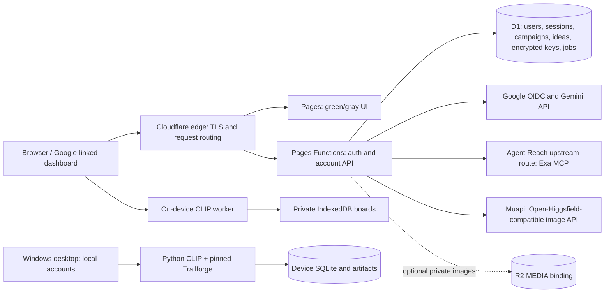
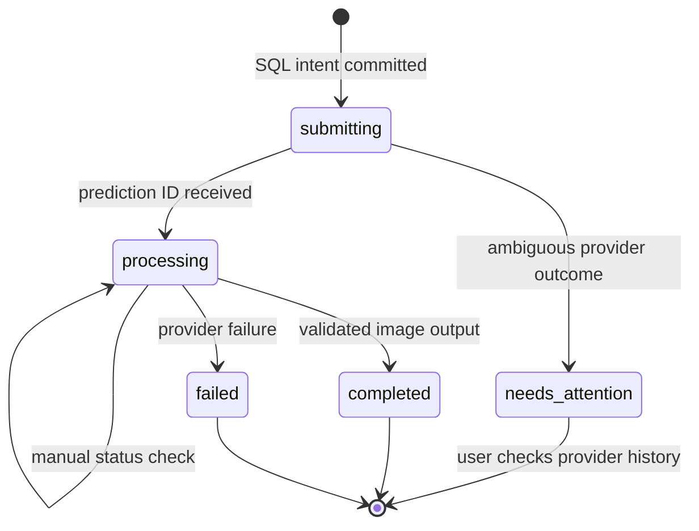

# Prism 0.5: account, research and design system

Updated 2026-10-11. This is the current implementation design and deployment runbook for a 10–30-user pilot. Earlier release documents describe earlier behavior.

## 1. What the user gets

Prism helps someone who has a product but few advertising ideas. They describe the product, market, audience and platform; gather source-linked references; optionally group product photographs or actual ads with CLIP; and ask Gemini for creative concepts. A Google-linked dashboard keeps campaign briefs, source lists, text analysis snapshots and saved concepts. The user can ask Gemini for two image prompts, review them, and request one or two product mockups through an image provider.

The green/gray interface retains local boards, uploads, search, analysis, export, catalogue research, Gemini grounded research and chat. Product listings and organic posts are labelled separately from verified paid ads. Similarity scores and creative hypotheses do not establish campaign performance, ad delivery in Pakistan, or a product's medical/cosmetic benefits.

**Implemented versus enabled:** the cloud backend, schema, dashboard, Google OIDC implementation, encrypted provider-key storage and image-job adapter are implemented and tested locally. Production account activation is blocked by the current Cloudflare token's denied D1 access and missing Google OAuth configuration. The available tools cannot control the user's signed-in Chrome session. No Google login, production database creation or paid image generation is claimed as completed. Exa's public search returned a real quota-exhausted result during this work; fixture search tests are separate evidence.

## 2. Architecture and load distribution

The initial backend uses Cloudflare's edge request routing and stateless Functions. A separate load-balancer instance, Kubernetes cluster, Redis or VM pool is unnecessary for this pilot. This is an architecture choice, not a load-test result. D1 is the shared source of account state. All reads and writes include the authenticated user ID; the browser never selects an arbitrary owner.

CLIP inference remains on the visitor's device, keeping CPU work and uploaded advertising pixels off the shared backend. External search and model inference use bounded HTTP adapters. Workers cannot run the Python CLIP/Trailforge process. Desktop visual workflows continue using Trailforge at `fbefaf40fb39a1429dcc328184372214f9fd849d`; browser account/provider operations have SQL job state, not Trailforge receipts.

Bindings and secrets are production-only; preview deployments must use separate test resources if accounts are later enabled there. Pages supports D1 and R2 bindings. [Cloudflare binding documentation](https://developers.cloudflare.com/pages/functions/bindings/).

## 3. Capacity assumptions and costs

Admission is capped at 30 distinct Google identities; `MAX_USERS=10` starts a smaller pilot. An optional invitation list restricts eligible emails. Assume at most five concurrently active people, 20 campaigns/person averaging 25 KB of text, and 50 saved concepts/person averaging 3 KB: roughly 20 MB of content before indexes and job history. These estimates need measurement with the pilot.

Application limits are 50 campaigns/account, 250,000 bytes/campaign, 150 individually saved ideas/account and 20,000 characters/idea. The maximum of all limits simultaneously is too close to the free database's capacity once indexes and jobs are included. Monitor storage at 250 MB; stop expansion and archive/export before 350 MB. Do not advertise the hard record limits as a guaranteed total storage allocation. D1's free database limit is 500 MB, with seven days of Time Travel recovery. [D1 limits](https://developers.cloudflare.com/d1/platform/limits/).

Per-account buckets limit general mutations to 600/day (key removal, logout and account deletion remain available), campaign saving to 600/hour, Gemini generation to 60/hour, web research to 20/hour, key/model changes to 30/hour, image generation to two jobs/day and status checks to 120/hour. These are pilot safeguards, not a billing guarantee. Old counters are deleted as each kind is used.

Indexed account lookups and bounded result sets should be comfortably below D1 free daily allowances under normal pilot use, but exact row counts, CPU and provider costs must be measured. D1 free allowances are five million rows read and 100,000 written daily; index updates count toward writes. [D1 pricing](https://developers.cloudflare.com/d1/platform/pricing/). Function request/CPU limits are shared with other workloads on the account. [Workers limits](https://developers.cloudflare.com/workers/platform/limits/).

No plan, card, credit purchase or billing switch is performed automatically. Gemini and Exa free availability depends on the user's key and provider quotas. Muapi image generation requires a valid key and provider credits; an open-source interface does not supply free inference. R2 is optional and unprovisioned. Its Standard free allowance is 10 GB-month storage plus bounded operation allowances; account-wide usage and billing enrollment still matter. [R2 pricing](https://developers.cloudflare.com/r2/pricing/).

## 4. Google login and sessions

1. Continue with Google calls `/api/cloud/auth/google`. It is disabled when database, OAuth client or vault configuration is absent.
2. The server creates a random state, nonce and PKCE verifier. Only the state hash and a ten-minute expiry are stored. The browser gets an HttpOnly, Secure, SameSite=Lax `__Host-prism-oauth` cookie.
3. Google returns a code to `https://prism-creative.pages.dev/api/cloud/auth/callback`. The server checks the cookie/state match and consumes the state once before exchanging the code.
4. Google's signed ID token is verified using its JWKS, RS256, issuer, audience, expiry, recent issue time, nonce and verified email. The stable `sub`, rather than a mutable email address, identifies the account.
5. Admission checks the invitation list and atomically caps new accounts. Existing identities can return without consuming another slot.
6. The server creates a random 30-day session. D1 stores only its SHA-256 hash and a CSRF token. The browser session cookie is HttpOnly/Secure/Lax. The UI gets identity and CSRF metadata, never a Google refresh/access token.
7. Every mutation checks exact same-origin `Origin` and `X-CSRF-Token`. Logout deletes that session. Expired OAuth states and sessions are cleaned during sign-in.

Only `openid email profile` scopes are requested. No Gmail, Drive or ad-account access is requested. The application does not need persistent Google API tokens to keep the user's Prism data. This follows [Google's web-server OAuth flow](https://developers.google.com/identity/protocols/oauth2/web-server) and [OpenID Connect validation rules](https://developers.google.com/identity/openid-connect/openid-connect).

Google testing-mode consent/test users or production publication must be configured in the user's Cloud Console. A signed-in browser by itself is not an OAuth client ID and secret. Native local accounts remain supported; Google cloud synchronization is implemented for the hosted website in this release, with native SSO a separate future integration.

## 5. Database and privacy model

The additive initial schema is [0001_accounts.sql](../browser/migrations/0001_accounts.sql).

| Table | Identity / relationship | Stored data |
|---|---|---|
| users | UUID; unique Google subject | Name, email, created time |
| sessions | Hash of opaque token; user FK | CSRF and expiry |
| oauth_states | Hash of state | Nonce, verifier, expiry; one use |
| campaigns | Composite user + campaign ID | Title, bounded JSON, version, timestamps |
| saved_ideas | Composite user + idea ID; owned campaign FK | Explicitly saved concept, timestamp |
| provider_keys | Composite user + provider | AES-GCM ciphertext, chosen model, timestamp |
| usage_buckets | User + kind + time bucket | Atomic quota counters |
| design_jobs | User + job ID; unique user + request key | Prompt, model, provider prediction ID, state, bounded output URLs |
| media | User + image ID; owned campaign FK | Optional private R2 key, byte count, MIME |

Composite foreign keys prevent attaching a record to another account's campaign. Campaign/account deletion cascades metadata; R2 objects are explicitly deleted first when present. Database/R2 deletion cannot form a single cross-service transaction: a failed object deletion stops metadata deletion; retry and reconciliation are operator duties. Optional upload writes reserve bytes in SQL before R2 upload and roll back metadata if upload fails. An object may still be orphaned after an ambiguous storage failure; reconciliation is a future scheduled maintenance job.

An account export includes campaigns, concepts and design metadata. It excludes API keys and image bytes. The delete-account UI requires the exact phrase `DELETE MY ACCOUNT`. A later provider-key deletion or sign-out does not silently erase campaigns.

## 6. Saving campaigns and ideas

The account cache is loaded before studio startup. It is authoritative across devices. Existing device work remains separate and is not silently assigned to whoever signs in. IndexedDB boards are filtered by account ID or the device workspace.

Campaign changes are debounced for 700 ms and serialized per campaign. Each save carries its last server version; D1 updates only that version. A conflict returns 409 and retains the local draft rather than overwriting newer device edits. Opening the latest account version permits deliberate reconciliation. Pending writes trigger a browser leave warning; delivery after closing a tab is not guaranteed. The sidebar reports saving, saved or an error. A stale account cannot overwrite another account's campaign.

Campaign payloads save the brief, reference metadata, selected IDs, source-linked web text, concepts, reviewed image prompts and a text-only board snapshot. Original uploaded files and vectors remain in IndexedDB/local desktop files. Cross-device restoration clears local board identifiers; historical snapshots are explicitly marked as not current analysis.

`Save idea` creates an independently retrievable account record only on explicit request. The dashboard lists those ideas per campaign and supports removing them. Generated concepts also remain in the campaign payload. Gemini chat history currently clears on reload; it is not advertised as a saved conversation.

Optional private R2 endpoints support explicit account images with JPEG/PNG/WebP byte signatures, 10 MiB/file, 30 files/account and a 100 MiB/account quota. The dashboard exposes separate explicit account uploads when MEDIA is configured. Automatic synchronization of whole CLIP boards is not part of this release. The UI states that originals remain device-side.

## 7. Permanent provider-key storage

Google-linked users can save Gemini, Muapi and optional Exa keys through private password fields. The server encrypts each key using AES-256-GCM with a fresh 96-bit IV and authenticated data containing format version, user ID and provider. Ciphertext cannot be moved between accounts/providers and decrypted successfully.

`VAULT_KEY` is a randomly generated 32-byte base64url secret held as a Cloudflare secret binding. It is not stored in D1, source code, browser storage or GitHub build output. API responses contain provider/model/update metadata only. Keys remain in the account until replaced, removed or the account is deleted. A key revocation at its provider still makes the stored key unusable.

Back up the vault key separately from database exports. Rotation requires decrypting with the old key and re-encrypting all rows with the new key in controlled maintenance, then switching the binding. The setup script refuses to replace an existing vault secret. Losing this secret means users must reconnect providers; backup ciphertext alone is insufficient. Restore procedures must test a fixture key before reconnecting production traffic.

Device-only mode retains the earlier in-memory Gemini connection and does not pretend to store a permanent key. Persistent keys require enabled Google account storage. Keys are never pasted into chat, URLs, errors or committed files.

## 8. Agent Reach integration

Inspected source: [Agent Reach](https://github.com/Panniantong/agent-reach) at `94f06c1969dfc1834001269d79d3ad0972d9dee6`, actual MIT license. The project is primarily an installer/doctor/configuration layer; its own guidance tells agents to call upstream tools directly. Therefore Prism uses its recommended Exa MCP route as a bounded tool adapter in both Python and Cloudflare, rather than trying to execute the installer inside a Worker.

`POST /api/cloud/research` requires a logged-in user and applies its quota; an optional encrypted Exa key is passed in an upstream header. Device research uses `/api/research/search`. The query includes the product, market and platform. The tool receives an objective to distinguish product references, organic posts and verified advertising. Only public HTTPS source links are retained, with provenance and retrieval time.

Responses are bounded to 200 KB, text to 30,000 characters and links to 12. SSE/JSON and provider quota signals are handled explicitly. Empty unsourced responses are errors. No Instagram session scraping, restricted-page bypass, browser cookies or password harvesting is integrated. Jina and social-account channels are not installed into production; the delivered integration is the upstream HTTP search route. Optional local package installation is isolated in .prism/agent-reach-env through scripts/setup_agent_reach.py --install; it does not run the upstream system installer or inspect personal browser configuration. [Exa MCP tool documentation](https://exa.ai/docs/get-started/exa-mcp).

Gemini receives the campaign context and resulting sourced text through the existing context builder; users can research with Agent Reach, then draft concepts or chat. Retrieved content is evidence, never authority to reveal keys, run shell commands or change system rules. A source describing an ad does not prove regional delivery. When public quotas fail, catalogue references and regional search links remain available.

## 9. Product-design generation

Inspected reference: [Open-Higgsfield-AI](https://github.com/Autom8AI/Open-Higgsfield-AI) at `b578108936e83a3b2a5e86644057a56f8aea73a1`. Its README claims MIT but the inspected revision contains no LICENSE file. No upstream UI/code is vendored. Prism has a clean-room adapter using the observed Muapi request/response protocol. This compatibility integration does not host Higgsfield or train/run image models locally.

1. The user chooses a current concept and clicks Create design prompts.
2. Gemini produces two bounded image prompts grounded in the brief and concept. They are proposed mockups, not verified accurate packaging.
3. A review dialog lets the user edit both prompts, select one or two images, and confirm use of provider credits. Copying prompts is available without generation.
4. The account must have a saved Muapi key and selected allowlisted model: `flux-dev-image` or `nano-banana`.
5. The UI creates a stable idempotency key per prompt request. SQL records `submitting` before any provider I/O. Each request asks for one image; two designs mean two explicit jobs.
6. A successful provider submission stores its prediction ID and changes to `processing`. A timeout/ambiguous error becomes `needs_attention`, preventing an automatic paid retry.
7. Manual status checks use the existing prediction ID. Completion stores bounded allowlisted output URLs; failure is recorded. Images are served through a private owner-checked proxy, with no provider key visible to the browser.
8. The dashboard shows job history and permits downloading completed images. Provider links can expire; generated bytes are not automatically archived in R2.

Retries with the same key return the existing job without generating again. An uncertain job may represent a charged provider submission and requires manual provider-history reconciliation. Costs are not claimed to be zero. The provider protocol can change; pinned reference review and contract tests are required before adding models. [Muapi documentation](https://muapi.ai/docs/introduction).

## 10. HTTP boundaries

| Endpoint under `/api/cloud` | Purpose |
|---|---|
| GET config | Boolean readiness; no secrets |
| GET auth/google, auth/callback | OIDC start and return |
| GET auth/me; POST auth/logout | Identity/provider metadata; session deletion |
| GET campaigns; GET/PUT/DELETE campaigns/:id | Owned metadata, versioned save and deletion |
| GET/POST campaigns/:id/ideas; DELETE ideas/:id | Individually saved ideas |
| GET keys; PUT/DELETE keys/:provider | Metadata, encrypted replacement or removal |
| POST gemini/models; PUT gemini/model | Provider discovery and verified selection |
| POST gemini/generate | Server-side Gemini using saved key |
| POST research | Bounded Agent Reach / Exa research |
| GET/POST designs; GET/POST designs/:id | Job history, explicit dispatch, manual polling |
| GET designs/:id/image?index=0 | Private bounded generated image proxy |
| POST media?campaign=:id; GET/DELETE media/:id | Optional private account image API (30 files/account) |
| GET account/export; DELETE account | Portable metadata and explicit deletion |

Mutation requests require same-origin cookies and CSRF, except the separate validated OAuth flow. Private responses use `no-store`. Provider hosts, image models and output domains are allowlisted. Request bodies, upstream responses and timeouts are bounded. Unknown operations fail closed. Errors omit raw SQL, provider response bodies, OAuth codes and credentials.

## 11. Deployment sequence

1. Keep the current public app usable while account configuration is absent. Finish browser/Python contract tests, production asset build and Pages Function compilation. Do not claim fixture OAuth or Muapi tests as live account/inference evidence.
2. In Cloudflare, obtain a token scoped to this account with Pages edit and D1 edit/read. The existing Pages-only token cannot create/query databases. Do not change unrelated projects or enable a paid plan.
3. Create a Google OAuth web client. Configure consent and invited test users as applicable. Register the exact production redirect above. Configure client ID and secret privately; Google login to Console is distinct from end-user login.
4. Generate a vault secret using a cryptographically secure 32-byte source; retain it privately. Set `CLOUDFLARE_API_TOKEN`, `CLOUDFLARE_ACCOUNT_ID`, `GOOGLE_CLIENT_ID`, `GOOGLE_CLIENT_SECRET`, `VAULT_KEY` and optional `ALLOWED_EMAILS` in process environment, never committed files or command history.
5. Run `.venv\Scripts\python.exe scripts/configure_cloud_accounts.py` for a read-only readiness/permission check. Its output contains flags and secret names, not values.
6. Run the same script with `--apply`. It creates/reuses only `prism-accounts`, applies the additive migration and binds `DB` to `prism-creative` production. It refuses to repoint an existing DB or replace the vault secret. A partial failed migration may leave an empty/recoverable database; no user tables are dropped.
7. Redeploy the tested commit through GitHub Actions. Configuration changes require redeployment. Keep provider keys user-scoped, rather than GitHub deployment secrets. R2 remains optional; enabling it requires a private `MEDIA` binding and a separate storage/account-cost check.
8. Validate `/api/cloud/config`, real Google login/logout, two distinct accounts' privacy, key replacement/persistence, campaign reload on a second device, 409 conflict behavior and account deletion using designated test accounts.
9. Make a real Exa search with source verification and one explicitly requested provider image using the user's credits. Verify output, private proxy and download. These gates remain open until genuine provider/account tests run.
10. Start with ten invited users. Measure database size, API latency, error rates, quota failures, provider spend and whether references help users develop useful creatives before expanding to 30.

The GitHub Pages workflow builds/tests/functions-compiles the commit before publication. Version tags run the Windows packaged CLIP/Trailforge smoke test and publish a private-repository portable download. A release does not automatically activate Google accounts or prove model quality. [Pages project configuration API](https://developers.cloudflare.com/api/resources/pages/subresources/projects/methods/edit/).

## 12. Reliability, recovery and scaling gates

The initial service avoids a long-running worker queue: provider inference is asynchronous on the provider, with SQL dispatch intent and explicit status checks. No silent multi-agent planning loop is introduced. If more users require reliable image archival or background processing, add Cloudflare Queues with idempotent consumers and R2 after measuring usage and getting provider/billing authorization.

Proposed pilot SLOs are 99% successful owned metadata operations excluding deliberate quota/validation responses, and p95 metadata latency under two seconds. They are targets, not measured results. Configure Cloudflare operational dashboards for request/error/CPU/D1-storage metrics; provider latency and failure counts need explicit aggregate telemetry before pilot launch. Never log keys, campaign text, emails, authorization codes or raw prompts. Current implementation has bounded errors and job history; a central redacted alerting pipeline is not installed.

Recover Pages by redeploying the last tested commit. A code rollback does not roll back data or schema. Take a private SQL export before migrations; restore to a separate D1 database and validate ownership/FKs before rebinding. Use Time Travel only within its verified retention. Back up the vault secret separately. Export account metadata and retain originals/generated downloads locally. R2 backups/retention and an automated restore drill remain rollout gates.

At 30 users or repeated latency/quota failures, measure the actual bottleneck first. Reduce autosave frequency or archive large payloads; move heavy artifacts to object storage; consider paid D1/Workers only with explicit budget authority. Moving Python/Trailforge agents to a service pool would require a separate authenticated service, durable host receipts, health checks and a load-balancer origin pool. Cloudflare edge routing alone does not load-balance an absent Python service.

## 13. Mapping to the user's production framework

| Framework area | Concrete plan / gate |
|---|---|
| P00 Product | Regional campaign brief → sourced references → editable concepts → optional mockups |
| P01 Architecture | Edge Functions, D1 per-owner state, on-device CLIP; design above |
| P02 Frontend | Green/gray studio, dashboard, accessible dialogs and status messages |
| P03 Backend | OIDC, CSRF, versioned campaign API, encrypted keys and private image proxy |
| P04 Orchestration | Finite research/generation calls; SQL image intent before external submission |
| P05 Modeling | Existing pinned CLIP; verified Gemini model discovery; two allowlisted image models |
| P06 Memory | Account campaigns/ideas/vault; local pixel artifacts remain explicitly separate |
| P07 Tools | Agent Reach upstream search and Muapi compatibility adapters, bounded provenance |
| P08 Multi-agent | Deferred; no additional agents needed for the first pilot |
| P09 Evaluation | Ownership/security/DOM contracts pass locally; live OAuth/image/pilot quality gates open |
| P10 Observability | Readiness and job states implemented; central aggregate metrics/alerts pending |
| P11 Security | Token validation, hashed sessions, AES-GCM/AAD, owner FKs, no raw-secret responses |
| P12 Reliability | CAS conflicts, dispatch idempotency, uncertain submission states, recovery plan |
| P13 Infrastructure | One production Pages project/D1; provision blocked by current token permissions |
| P14 Data | Provenance labels, bounded schema, explicit account deletion/export, original-image limits |
| P15 Governance | No fabricated ad delivery/performance; upstream license uncertainty recorded |
| P16 Economics | Per-user quotas, optional paid generation confirmation, no automatic plan purchase |
| P17 Development | Reviewable source changes, pinned dependencies, source and SQLite integration tests |
| P18 CI/CD | Exact commit web deploy and tagged Windows build/smoke; evidence recorded separately |
| P19 Human | Editable concepts/prompts, opt-in credits, explicit destructive account deletion |
| P20 Learning | No automatic model training or marketing claims; pilot feedback before improvements |

Framework source remains the user's Production AI Thinking Framework PDF referenced by [PLAN.md](PLAN.md). Its example instructions are planning material; the current user request authorizes the implementation and deployment scope. This design does not close the earlier held-out CLIP, campaign-effectiveness or human-pilot gates without new evidence.
